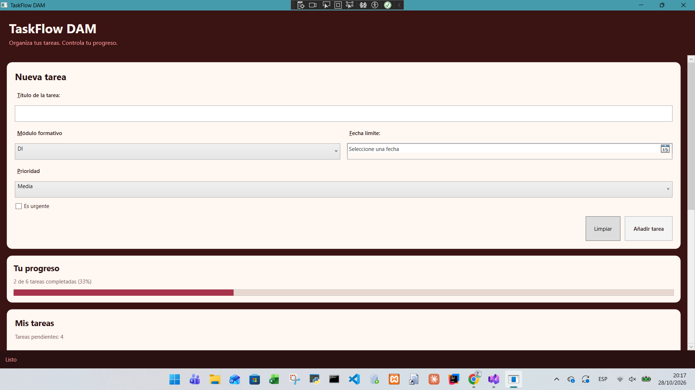
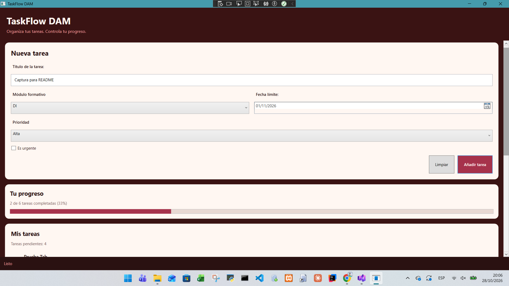

# TaskFlow DAM

Aplicación de escritorio desarrollada con **C# y WPF** para organizar las tareas académicas, consultar el progreso y gestionar las actividades pendientes desde una interfaz sencilla y accesible.

## 1. Descripción del proyecto

TaskFlow DAM permite registrar y organizar las tareas de los distintos módulos del ciclo formativo de Desarrollo de Aplicaciones Multiplataforma (DAM).

La interfaz está diseñada para facilitar la consulta de las tareas y del progreso general, utilizando una distribución por secciones, controles de entrada y una lista de tareas interactiva.

## 2. Tecnologías utilizadas

- **Lenguaje:** C#.
- **Framework de interfaz:** Windows Presentation Foundation (WPF).
- **Interfaz gráfica:** XAML.
- **Persistencia de datos:** Entity Framework Core y SQLite.
- **Actualización de la interfaz:** Data Binding, `INotifyPropertyChanged` y `ObservableCollection`.

## 3. Funcionalidades principales

- **Creación de tareas:** permite introducir el título, seleccionar el módulo, establecer una fecha límite y elegir la prioridad.
- **Gestión de urgencia:** permite marcar las tareas como urgentes.
- **Listado de tareas:** muestra la información de las tareas registradas.
- **Seguimiento del progreso:** actualiza los indicadores de progreso y las tareas pendientes.
- **Finalización de tareas:** permite cambiar su estado mediante una casilla de verificación.
- **Eliminación de tareas:** permite eliminar tareas con confirmación.
- **Validación de datos:** evita registrar tareas sin título.
- **Persistencia:** almacena los datos mediante SQLite para conservarlos entre ejecuciones.
- **Actualización reactiva:** refleja los cambios en la interfaz mediante los mecanismos de enlace de datos de WPF.

## 4. Diseño de la interfaz

La aplicación utiliza una distribución organizada en varias secciones:

- **Cabecera:** muestra el nombre de la aplicación y su descripción.
- **Nueva tarea:** contiene los campos necesarios para registrar una actividad.
- **Progreso:** presenta el avance de las tareas.
- **Lista de tareas:** permite consultar, completar y eliminar las actividades.
- **Barra inferior:** muestra información sobre el estado de la aplicación.

La paleta de colores combina tonos granate, crema y rosa para mantener una identidad visual coherente.

| Color | Código hexadecimal |
|---|---|
| Granate principal | `#3A1313` |
| Fondo crema | `#FFF7F2` |
| Granate secundario | `#733232` |
| Rosa oscuro | `#A6324B` |
| Texto oscuro | `#2A1111` |
| Texto secundario | `#7A5C5C` |
| Rosa claro | `#FFA4A4` |

## 5. Evidencias visuales

### Estado inicial de la aplicación

Se muestra la interfaz de TaskFlow DAM al iniciarse, con el formulario preparado para introducir una nueva tarea.

### Interfaz con una tarea registrada

Se muestra la interfaz con los campos cumplimentados y una tarea registrada, como evidencia del funcionamiento de la aplicación.

## 6. Aspectos técnicos

### Data Binding y actualización de datos

La interfaz se conecta con los datos de la aplicación mediante Data Binding. La implementación utiliza `INotifyPropertyChanged` para notificar cambios en las propiedades y `ObservableCollection` para actualizar la lista cuando se modifican las tareas.

### Persistencia con SQLite

Se utiliza Entity Framework Core junto con SQLite para almacenar las tareas. De este modo, los datos no dependen únicamente de la memoria de la aplicación y pueden conservarse al cerrar y volver a abrir el programa.

### Validación y confirmaciones

La aplicación comprueba que el título de una tarea no esté vacío antes de registrarla. También solicita confirmación antes de eliminar una tarea, evitando borrados accidentales.

## 7. Mejoras personales implementadas

Además de las funcionalidades principales, se han incorporado diferentes mejoras para optimizar la experiencia de uso:

- **Desplazamiento con la rueda del ratón:** se ha añadido un comportamiento específico para permitir desplazarse por el contenido de la lista de tareas utilizando la rueda del ratón.
- **Navegación mediante teclado:** se ha revisado el orden de tabulación para facilitar el recorrido por los controles.
- **Atajos de teclado:** se han configurado las teclas Enter para añadir tareas, Escape para limpiar el formulario y Alt + E para activar la opción de urgencia.
- **Etiquetas y mnemónicos:** se han asociado las etiquetas a sus controles mediante `Target`, facilitando su activación con el teclado.
- **Propiedades de accesibilidad:** se han añadido `AutomationProperties.Name` y `AutomationProperties.HelpText` para mejorar la identificación de los controles mediante tecnologías de asistencia.
- **Tamaño de los controles:** se han ajustado las dimensiones mínimas de los botones para facilitar su interacción.
- **Separación visual:** se han aumentado los márgenes entre los elementos de la lista para mejorar la lectura.
- **Estados de los botones:** se han personalizado los colores de los controles deshabilitados para mantener una buena legibilidad.
- **Información de estado:** se han incorporado mensajes para informar al usuario cuando añade una tarea o limpia el formulario.
- **Actualización automática:** los indicadores de progreso y el número de tareas pendientes se actualizan cuando cambia el estado de las tareas.

## 8. Usabilidad y accesibilidad

Durante la revisión de la interfaz se tuvieron en cuenta los siguientes aspectos:

- Contraste entre el texto y los fondos.
- Identificación y comprensión de los controles.
- Navegación mediante teclado.
- Uso de mnemónicos y etiquetas asociadas a los controles.
- Información accesible para tecnologías de asistencia.
- Tamaño y separación de los elementos interactivos.
- Comportamiento de los controles habilitados y deshabilitados.
- Desplazamiento por el contenido cuando es necesario.

También se realizaron comprobaciones con Narrador para verificar que los controles proporcionan información comprensible a las tecnologías de asistencia.

## 9. Pruebas realizadas

| Prueba | Resultado |
|---|---|
| Crear una tarea con los campos cumplimentados | Correcto |
| Intentar crear una tarea sin título | Correcto |
| Cambiar el estado de una tarea | Correcto |
| Eliminar una tarea | Correcto |
| Consultar las tareas registradas | Correcto |
| Cerrar y volver a abrir la aplicación | Correcto |
| Navegar por los controles con el teclado | Correcto |
| Utilizar los atajos de teclado | Correcto |
| Comprobar el contraste de los colores | Correcto en las combinaciones revisadas |
| Comprobar el desplazamiento del contenido | Correcto |
| Comprobar la lectura mediante Narrador | Correcto |

## 10. Ejecución del proyecto

1. Abrir la solución o el proyecto en Visual Studio.
2. Comprobar que están disponibles las dependencias de Entity Framework Core y SQLite.
3. Restaurar los paquetes NuGet si fuera necesario.
4. Compilar el proyecto.
5. Ejecutar la aplicación desde el entorno de desarrollo.

## 11. Conclusión

TaskFlow DAM reúne las funcionalidades básicas de una aplicación de gestión de tareas y aplica conceptos fundamentales de desarrollo de interfaces con WPF: separación entre interfaz y datos, enlace de datos, actualización reactiva y persistencia.

Además, se han incorporado mejoras personales centradas en la accesibilidad, la navegación mediante teclado y la comodidad de uso, consiguiendo una aplicación más completa y adaptada a las necesidades del usuario.